# Matriz editorial — centro-oeste

Original 4T2025: `BRAIN-Panorama-Regiao-Centro_Oeste_4T2025_VAP_20fev_17h15.pptx`. 52 posições. Miniaturas renderizadas pelo PowerPoint; classificação das páginas raster conferida visualmente em 26/11/2026. Número original permanece no diagnóstico; navegação usa páginas físicas.

|Ref.|Miniatura|Título / função|Fonte|Gráfico / quadro no sistema|Ação|
|---:|---|---|---|---|---|
|1||4º TRIMESTRE/2025 · institucional/abertura|Original institucional / metodologia do motor|texto/tabela/imagem · `cover`|Recompor com dados da competência; continuações adjacentes|
|2||Sobre a Brain · institucional/abertura|Arte original 4T2025, conteúdo aprovado pelo usuário para 3T2026 em 26/11/2026|texto/tabela/imagem · `about-brain`|Preservar arte e posição; conteúdo institucional aprovado pelo usuário em 26/11/2026 para 3T2026|
|3||Nossa atuação · institucional/abertura|Original institucional / metodologia do motor|texto/tabela/imagem · `brain-studies`|Recompor com dados da competência; continuações adjacentes|
|4||Grupo Brain · institucional/abertura|Arte original 4T2025, conteúdo aprovado pelo usuário para 3T2026 em 26/11/2026|texto/tabela/imagem · `brain-group`|Preservar arte e posição; conteúdo institucional aprovado pelo usuário em 26/11/2026 para 3T2026|
|5|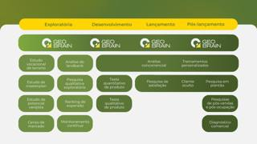|Estudos Geobrain · institucional/abertura|Original institucional / metodologia do motor|texto/tabela/imagem · `geobrain-studies`|Recompor com dados da competência; continuações adjacentes|
|6||Plataforma Geobrain · institucional/abertura|Arte original 4T2025, conteúdo aprovado pelo usuário para 3T2026 em 26/11/2026|texto/tabela/imagem · `geobrain-platform`|Preservar arte e posição; conteúdo institucional aprovado pelo usuário em 26/11/2026 para 3T2026|
|7||Aplicativo Geobrain · institucional/abertura|Arte original 4T2025, conteúdo aprovado pelo usuário para 3T2026 em 26/11/2026|texto/tabela/imagem · `geobrain-app`|Preservar arte e posição; conteúdo institucional aprovado pelo usuário em 26/11/2026 para 3T2026|
|8||Anuário de Cases de Sucesso · exclusão|Original institucional / metodologia do motor|texto/tabela/imagem · `excluded-yearbook`|Excluir por pedido explícito|
|9||Documentário Terreno de Mudanças · exclusão|Original institucional / metodologia do motor|texto/tabela/imagem · `excluded-documentary`|Excluir por pedido explícito|
|10|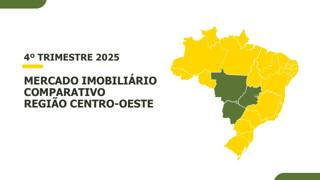|MERCADO IMOBILIÁRIO COMPARATIVO  REGIÃO CENTRO-OESTE · institucional/abertura|Original institucional / metodologia do motor|texto/tabela/imagem · `regional-opening`|Recompor com dados da competência; continuações adjacentes|
|11|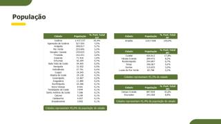|Cidades analisadas · institucional/abertura|Catálogo autorizado; população/data-base/denominador pendentes|texto/tabela/imagem · `scope`|Recompor com dados da competência; continuações adjacentes|
|12||Objetivos e metodologia · institucional/abertura|Original institucional / metodologia do motor|texto/tabela/imagem · `methodology`|Recompor com dados da competência; continuações adjacentes|
|13||Destaques · institucional/abertura|Original institucional / metodologia do motor|texto/tabela/imagem · `section-highlights`|Recompor com dados da competência; continuações adjacentes|
|14|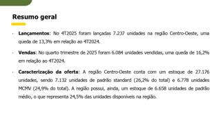|Resumo geral · indicador|API Geobrain / histórico da competência / INCC-DI nos fluxos monetários|texto/tabela/imagem · `summary`|Recompor com dados da competência; continuações adjacentes|
|15|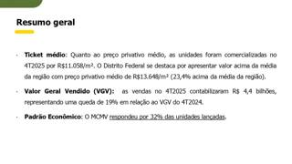|Resumo geral · preços e segmentos · indicador|API Geobrain / histórico da competência / INCC-DI nos fluxos monetários|texto/tabela/imagem · `summary-prices`|Recompor com dados da competência; continuações adjacentes|
|16|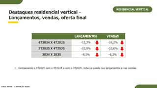|Destaques residencial vertical - Lançamentos, vendas, oferta final · indicador|API Geobrain / histórico da competência / INCC-DI nos fluxos monetários|texto/tabela/imagem · `highlights-Residencial vertical`|Recompor com dados da competência; continuações adjacentes|
|17|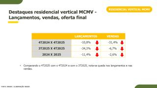|Destaques residencial vertical MCMV - Lançamentos, vendas, oferta final · indicador|API Geobrain / histórico da competência / INCC-DI nos fluxos monetários|texto/tabela/imagem · `highlights-MCMV`|Recompor com dados da competência; continuações adjacentes|
|18|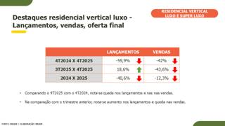|Destaques residencial vertical luxo - Lançamentos, vendas, oferta final · indicador|API Geobrain / histórico da competência / INCC-DI nos fluxos monetários|texto/tabela/imagem · `highlights-Luxo`|Recompor com dados da competência; continuações adjacentes|
|19||section-releases · indicador|API Geobrain / histórico da competência / INCC-DI nos fluxos monetários|texto/tabela/imagem · `section-releases`|Recompor com dados da competência; continuações adjacentes|
|20|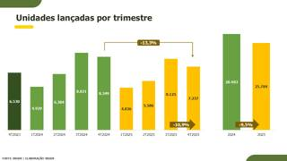|Unidades lançadas por trimestre · indicador|API Geobrain / histórico da competência / INCC-DI nos fluxos monetários|COLUMN_CLUSTERED (51), COLUMN_CLUSTERED (51) · `releases-units-quarters`|Recompor com dados da competência; continuações adjacentes|
|21|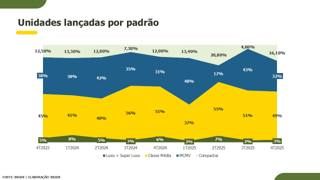|Unidades lançadas por padrão · indicador|API Geobrain / histórico da competência / INCC-DI nos fluxos monetários|AREA_STACKED (76) · `releases-units-standards`|Recompor com dados da competência; continuações adjacentes|
|22|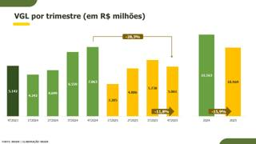|VGL por trimestre (em R$ milhões) · indicador|API Geobrain / histórico da competência / INCC-DI nos fluxos monetários|COLUMN_CLUSTERED (51), COLUMN_CLUSTERED (51) · `releases-money-quarters`|Recompor com dados da competência; continuações adjacentes|
|23|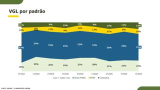|VGL por padrão · indicador|API Geobrain / histórico da competência / INCC-DI nos fluxos monetários|AREA_STACKED (76) · `releases-money-standards`|Recompor com dados da competência; continuações adjacentes|
|24|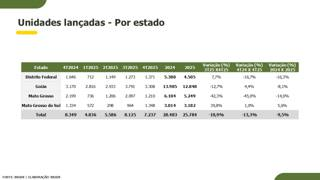|Unidades lançadas - Por estado · indicador|API Geobrain / histórico da competência / INCC-DI nos fluxos monetários|texto/tabela/imagem · `releases-states`|Recompor com dados da competência; continuações adjacentes|
|25||section-sales · indicador|API Geobrain / histórico da competência / INCC-DI nos fluxos monetários|texto/tabela/imagem · `section-sales`|Recompor com dados da competência; continuações adjacentes|
|26|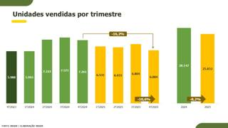|Unidades vendidas por trimestre · indicador|API Geobrain / histórico da competência / INCC-DI nos fluxos monetários|COLUMN_CLUSTERED (51), COLUMN_CLUSTERED (51) · `sales-units-quarters`|Recompor com dados da competência; continuações adjacentes|
|27|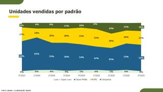|Unidades vendidas por padrão · indicador|API Geobrain / histórico da competência / INCC-DI nos fluxos monetários|AREA_STACKED (76) · `sales-units-standards`|Recompor com dados da competência; continuações adjacentes|
|28|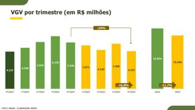|VGV por trimestre (em R$ milhões) · indicador|API Geobrain / histórico da competência / INCC-DI nos fluxos monetários|COLUMN_CLUSTERED (51), COLUMN_CLUSTERED (51) · `sales-money-quarters`|Recompor com dados da competência; continuações adjacentes|
|29||VGV por padrão · indicador|API Geobrain / histórico da competência / INCC-DI nos fluxos monetários|AREA_STACKED (76) · `sales-money-standards`|Recompor com dados da competência; continuações adjacentes|
|30|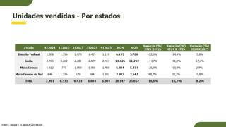|Unidades vendidas - Por estados · indicador|API Geobrain / histórico da competência / INCC-DI nos fluxos monetários|texto/tabela/imagem · `sales-states`|Recompor com dados da competência; continuações adjacentes|
|31||COMPARATIVO LANÇAMENTOS, VENDAS E ESTOQUE REGIÃO CENTRO-OESTE · indicador|API Geobrain / histórico da competência / INCC-DI nos fluxos monetários|texto/tabela/imagem · `section-comparison`|Recompor com dados da competência; continuações adjacentes|
|32|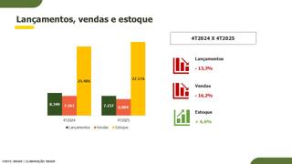|Lançamentos, vendas e estoque · indicador|API Geobrain / histórico da competência / INCC-DI nos fluxos monetários|COLUMN_CLUSTERED (51) · `comparison`|Recompor com dados da competência; continuações adjacentes|
|33||ANÁLISE GERAL · indicador|API Geobrain / histórico da competência / INCC-DI nos fluxos monetários|texto/tabela/imagem · `section-analysis`|Recompor com dados da competência; continuações adjacentes|
|34|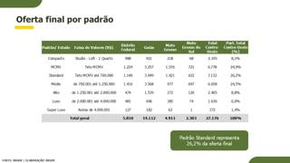|Oferta final por padrão · indicador|API Geobrain / histórico da competência / INCC-DI nos fluxos monetários|texto/tabela/imagem · `stock-Padrão`|Recompor com dados da competência; continuações adjacentes|
|35|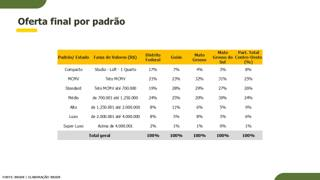|Oferta final por padrão · indicador|API Geobrain / histórico da competência / INCC-DI nos fluxos monetários|texto/tabela/imagem · `stock-Padrão-states`|Recompor com dados da competência; continuações adjacentes|
|36|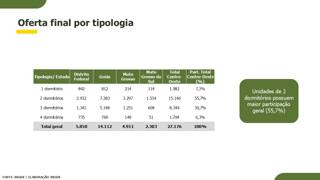|Oferta final por tipologia · indicador|API Geobrain / histórico da competência / INCC-DI nos fluxos monetários|texto/tabela/imagem · `stock-Tipologia`|Recompor com dados da competência; continuações adjacentes|
|37|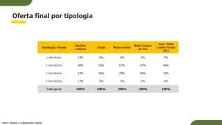|Oferta final por tipologia · indicador|API Geobrain / histórico da competência / INCC-DI nos fluxos monetários|texto/tabela/imagem · `stock-Tipologia-states`|Recompor com dados da competência; continuações adjacentes|
|38|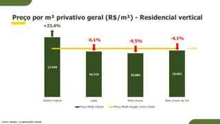|Preço por m² privativo geral (R$/m²) - Residencial vertical · indicador|API Geobrain / histórico da competência / INCC-DI nos fluxos monetários|COLUMN_CLUSTERED (51) · `meter-states`|Recompor com dados da competência; continuações adjacentes|
|39|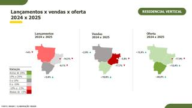|RESIDENCIAL VERTICAL · indicador|API Geobrain / histórico da competência / INCC-DI nos fluxos monetários|texto/tabela/imagem · `annual-state-comparison`|Recompor com dados da competência; continuações adjacentes|
|40|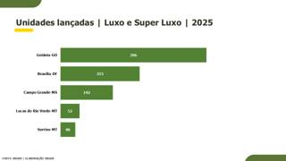|Unidades lançadas  /  Luxo e Super Luxo  /  2025 · indicador|API Geobrain / histórico da competência / INCC-DI nos fluxos monetários|BAR_CLUSTERED (57) · `ranking-Luxo`|Recompor com dados da competência; continuações adjacentes|
|41|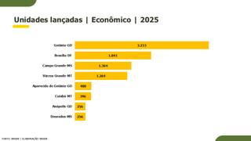|Unidades lançadas  /  Econômico  /  2025 · indicador|API Geobrain / histórico da competência / INCC-DI nos fluxos monetários|BAR_CLUSTERED (57) · `ranking-MCMV`|Recompor com dados da competência; continuações adjacentes|
|42|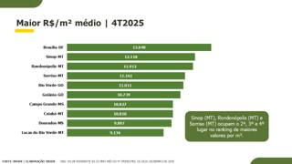|OBS: VALOR REFERENTE AO ÚLTIMO MÊS DO 4º TRIMESTRE, OU SEJA, DEZEMBRO DE 2025 · indicador|API Geobrain / histórico da competência / INCC-DI nos fluxos monetários|BAR_CLUSTERED (57) · `ranking-meter`|Recompor com dados da competência; continuações adjacentes|
|43|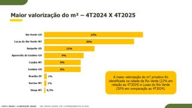|Maior valorização do m² – 4T2024 X 4T2025 · indicador|API Geobrain / histórico da competência / INCC-DI nos fluxos monetários|BAR_CLUSTERED (57) · `ranking-variation`|Recompor com dados da competência; continuações adjacentes|
|44||MAPAS DE LOCALIZAÇÃO · institucional/abertura|Original institucional / metodologia do motor|texto/tabela/imagem · `section-maps`|Recompor com dados da competência; continuações adjacentes|
|45|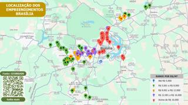|LOCALIZAÇÃO DOS EMPREENDIMENTOS · localização|API Geobrain / histórico da competência / INCC-DI nos fluxos monetários|texto/tabela/imagem · `map:BRASÍLIA`|Recompor com dados da competência; continuações adjacentes|
|46|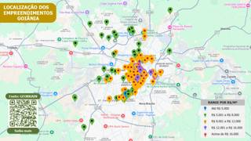|LOCALIZAÇÃO DOS EMPREENDIMENTOS · localização|API Geobrain / histórico da competência / INCC-DI nos fluxos monetários|texto/tabela/imagem · `map:GOIÂNIA`|Recompor com dados da competência; continuações adjacentes|
|47|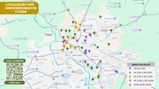|LOCALIZAÇÃO DOS EMPREENDIMENTOS · localização|API Geobrain / histórico da competência / INCC-DI nos fluxos monetários|texto/tabela/imagem · `map:CUIABÁ`|Recompor com dados da competência; continuações adjacentes|
|48|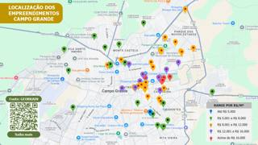|LOCALIZAÇÃO DOS EMPREENDIMENTOS · localização|API Geobrain / histórico da competência / INCC-DI nos fluxos monetários|texto/tabela/imagem · `map:CAMPO GRANDE`|Recompor com dados da competência; continuações adjacentes|
|49||Equipe técnica · institucional/abertura|Arte original 4T2025, conteúdo aprovado pelo usuário para 3T2026 em 26/11/2026|texto/tabela/imagem · `team`|Preservar arte e posição; conteúdo institucional aprovado pelo usuário em 26/11/2026 para 3T2026|
|50||Consultoria · institucional/abertura|Arte original 4T2025, conteúdo aprovado pelo usuário para 3T2026 em 26/11/2026|texto/tabela/imagem · `consulting`|Preservar arte e posição; conteúdo institucional aprovado pelo usuário em 26/11/2026 para 3T2026|
|51||Aplicativo Brain · institucional/abertura|Arte original 4T2025, conteúdo aprovado pelo usuário para 3T2026 em 26/11/2026|texto/tabela/imagem · `institutional-app`|Preservar arte e posição; conteúdo institucional aprovado pelo usuário em 26/11/2026 para 3T2026|
|52||Contracapa · institucional/abertura|Arte original 4T2025, conteúdo aprovado pelo usuário para 3T2026 em 26/11/2026|texto/tabela/imagem · `closing`|Preservar arte e posição; conteúdo institucional aprovado pelo usuário em 26/11/2026 para 3T2026|
